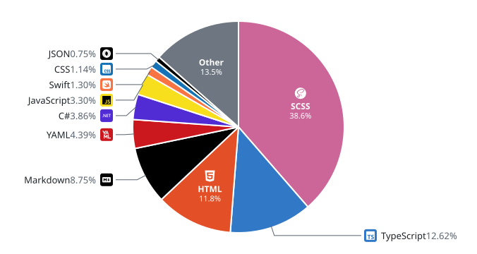
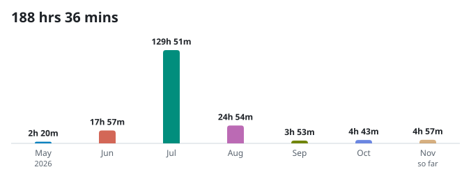

## 🏆 Top 10 Languages (May 2026 - Present)
<!--START_SECTION:top-lang-->
<picture>
  <source media="(prefers-color-scheme: dark)" srcset="assets/languages-dark.svg">
  
</picture>
<!--END_SECTION:top-lang-->

## ⏱️ Code Time (May 2026 - Present)
<!--START_SECTION:code-time-->
<picture>
  <source media="(prefers-color-scheme: dark)" srcset="assets/code-time-dark.svg">
  
</picture>
<!--END_SECTION:code-time-->
