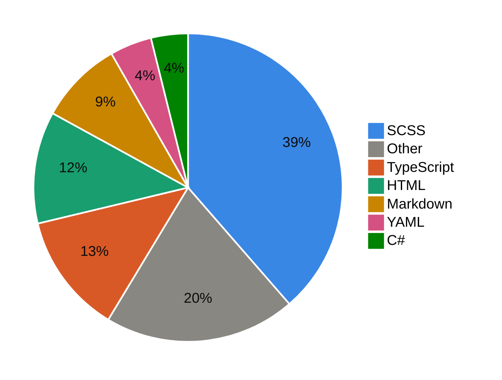

## 🏆 Top 10 Languages (May 2026 - Present)
<!--START_SECTION:top-lang-->

&nbsp;&nbsp;&nbsp;&nbsp;&nbsp;&nbsp;&nbsp;&nbsp;&nbsp;&nbsp;&nbsp;&nbsp;&nbsp;&nbsp;&nbsp;&nbsp;&nbsp;&nbsp;&nbsp;&nbsp;&nbsp;&nbsp;&nbsp;&nbsp;&nbsp;&nbsp;&nbsp;&nbsp;&nbsp;&nbsp;
<!--END_SECTION:top-lang-->

## ⏱️ Code Time (May 2026 - Present)
<!--START_SECTION:code-time-->

<!--END_SECTION:code-time-->
